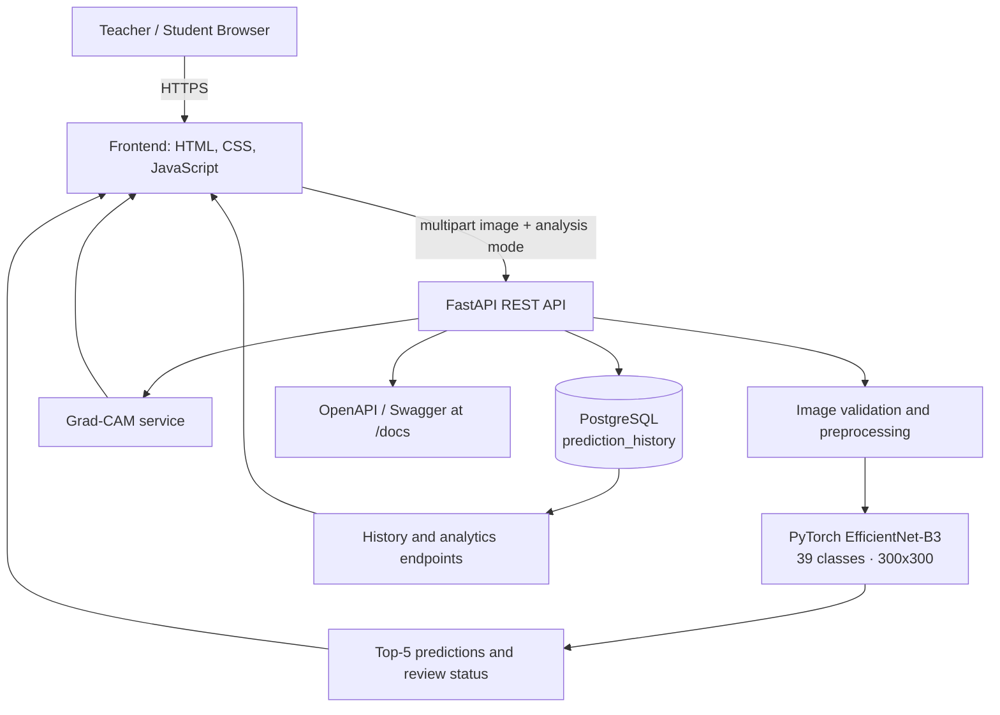

# System Architecture

The deployment is designed as one public HTTPS origin: FastAPI serves the frontend and API from the same Render Docker service. The model checkpoint is downloaded from a separately hosted artifact URL at startup when it is not present on disk.

## Data flow

1. The browser validates the selected image size/type and previews it locally.
2. The frontend sends `POST /api/v1/predict` with the image and `analysis_mode` form field.
3. The API validates and decodes the image, then calls the EfficientNet-B3 predictor.
4. The model returns top-5 class scores, confidence margin, background/healthy/review status and (for experimental multi-region mode) crop-level predictions.
5. Prediction metadata is saved to PostgreSQL when `DATABASE_URL` is configured and reachable.
6. The frontend requests `POST /api/v1/gradcam` to generate an optional input/heatmap/overlay explanation.
7. The user can inspect saved history and analytics through the REST API.
